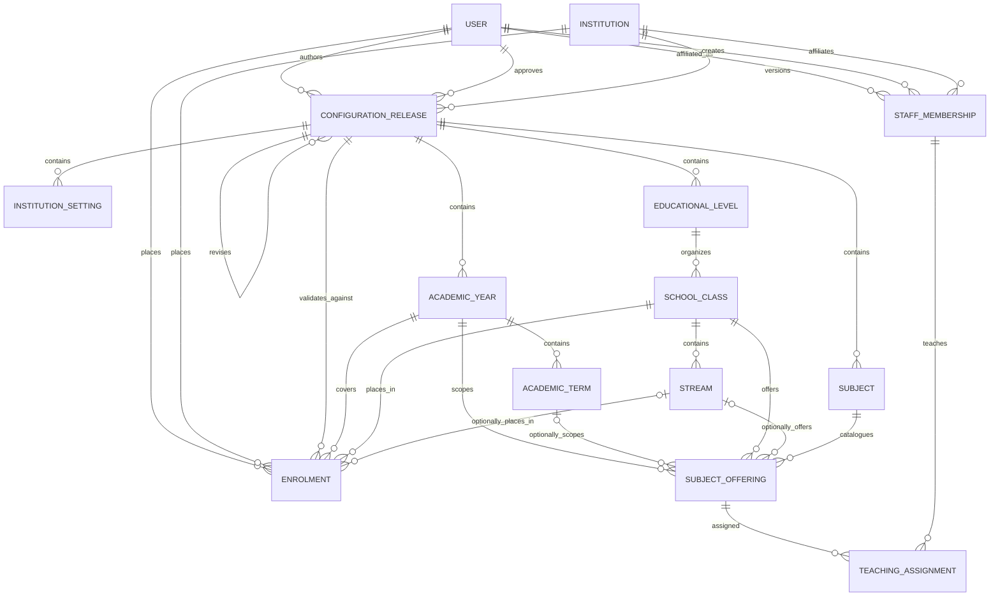

# Institutional and Phase 04 academic data architecture

## Status and scope

Prompt 03 introduced the `institutional` app and `0001_initial` migration. Phase 04 adds the separate `academic` app and `0001_initial` migration for candidate, guardian, BA-0 and weekly/mock **source** records. Both migrations are exercised only in disposable tests and the configured disposable PostgreSQL CI service; neither has been applied to shared/production infrastructure. No school rows, role grants or policy values are seeded. Identity MFA/recovery tables retain their earlier CI-only table-creation arrangement.

The **institutional** schema remains a configuration foundation and contains no learner names or guardian contact details. Phase 04 now provides a scoped Candidate identity and Guardian/Link, typed CandidatePlacement, BA-0 observation, weekly assessment and monthly mock source schema in **academic**. It does **not** create attendance, intervention, predictive reporting, fee, allowance, payment, receipt or ledger records. See the [Phase 04 report](../prompt-04-candidate-academic-operations.md) for policy limits.

## Implemented institutional entities

### Tenant and release boundary

- `Institution` is a UUID tenant root with an owner-entered code and name; timezone and locale are not stored on this unversioned row. No institution is seeded.
- `ConfigurationRelease` identifies an institution, immutable revision number, optional approved source revision, explicit `effective_from` date, author, submission evidence and independent approver evidence. Draft → submitted → approved is the only forward lifecycle. Author self-approval, reopening and approved edits are rejected; one approved release may begin on a given date per institution.
- Release-scoped settings, calendar, class/stream, subject/offering and teaching-assignment records use UUIDs. Foreign-key dependencies must belong to the same release (and, for staff affiliations, the same institution). A revision may clone a prior approved snapshot, leaving that earlier release intact.
- Effective-release resolution requires a caller-supplied institution-local `date`. The application does not guess timezone, locale or calendar policy.

### Configuration catalogue

- `InstitutionSetting` stores typed, versioned JSON values (`text`, `integer`, `decimal`, `boolean`, `date`, or `json`). Password-, secret-, token-, credential- and API-key-like keys or nested fields are rejected. This is not a secret store.
- `AcademicYear` and `AcademicTerm` model dates and within-year sequence; `EducationalLevel`, `SchoolClass` and `Stream` model structural placement. Dates, codes and labels are entered by authorized users; the project does not presume a local academic calendar, class names or policies.
- `Subject` and `SubjectOffering` model a catalogue and its class/stream/year/term relationships. No subject list is embedded in code.
- `TeachingAssignment` links an offering to an institution staff affiliation with an effective period. It does not create RBAC permissions or imply an approved teaching policy.

### Staff and enrolment foundations

- `InstitutionStaffMembership` links an existing active account to an institution over an effective period. It is distinct from an `AccessRole`, permission or scope grant; affiliation never grants authorization. Account provisioning and role assignment remain separate processes.
- `Enrolment` stores institution, approved release, academic year, class, optional stream, dates, creator and an opaque UUID `learner_reference`. It contains no names or contact details; Phase 04 `CandidatePlacement` now links it to the institution-scoped Candidate UUID. This link is validated under a transaction, not inferred from matching loose strings.
- Teaching assignments and enrolment placements are checked against institution/revision/year/class/stream dependencies and effective-period order. Membership and enrolment changes are restricted to closing open periods; the original placement facts are not rewritten.

## Integrity, permissions and audit

- Database constraints enforce scoped code uniqueness, date order, revision uniqueness, and required relationships. Model/service validation enforces cross-table dependency and effective-date invariants; API serializers also limit related objects to the route institution/revision.
- Reads and writes are authorized by server-side RBAC at the exact institution scope. Global institution creation is separately gated, and creating an institution does not grant a read or management scope.
- Release changes, configuration record writes, membership actions and enrolment actions record allow-listed audit evidence without request bodies, credentials or learner personal data. ORM guards do not protect against raw SQL, database owners or privileged compromise; database-level immutability and retention remain open governance/security gates.
- No role, permission, user, school, calendar, class, subject, rate, fee, entitlement or finance data is seeded.

## Compatibility boundary for AIM-01 through AIM-06

Future authorized modules may build on stable institution/release UUIDs, academic-year/term and class/stream references, subject offerings, staff affiliation/teaching assignment, exact-scope RBAC and the opaque learner reference. They must define their own policy versions, approvals, validation, audit, privacy and migrations. Phase 04 creates the narrow source endpoints listed below, not complete AIM modules; later work must not infer module-specific semantics from identifiers alone.

## Production and design gates

Before any shared or production use: Owner acceptance of this implementation; field-level schema/security review; decisions on account/grant provisioning, school permission scopes, audit retention/DB immutability, effective-date interpretation and migration ownership; an approved migration/rollback or forward-fix plan; backup/restore evidence; controlled synthetic-to-real onboarding; independent security/accessibility review; and a separate deployment authorization. No production database was contacted by this work.

## Phase 04 academic source entities

| Group | Key relationships and invariants |
|---|---|
| Candidate / CandidatePlacement / CandidateChange / CandidateImport | Candidate is a tenant UUID with status/version, optional birth date and HMAC exact-match guard; CandidatePlacement is a typed one-to-one link to an institutional Enrolment in the same institution. Reasoned changes are append-only. An import batch binds institution, actor, idempotency UUID, HMAC payload digest, error count and applied timestamp; no CSV or names are stored in audit metadata. |
| Guardian / GuardianLink / evidence | Guardian contact is a tenant-scoped private record; a link has relationship and independent active/contact flags. Profile/link views mask unauthorized contact. Guardian administrative directory requires a separate grant; reasoned field/link histories are retained. |
| Baseline / BaselineObservation / BaselineCorrection | Each candidate-year starts at revision 1. Raw state and optional decimal score/max live on offering-bound observations; an approved baseline has a digest, independent checker and immutable content. Correction authorization creates exactly one successor draft pointing at the approved predecessor. Coverage is explicitly **not verified**. |
| AcademicActivity / ActivitySubject / ActivityParticipant / AcademicMark / ActivityCorrection | A weekly event binds one active teacher assignment and its offering; a Basic 9 mock has an operator-declared blueprint. Eligible roster and subject mark cells carry explicit missing/absent/not-assessed/scored states and versions. Moderation/approval/publication are separate; correction is an authorized new revision. |

All Phase 04 rows retain institution-anchored parent FKs and ordinary ORM write guards, with database constraints for important uniqueness, score/date and revision invariants. PostgreSQL direct SQL/DB-owner mutation is **not** prevented by application-level guards; it needs a reviewed DB-level audit/immutability and backup plan before real use. No grade formula, subject-coverage policy, prediction, WAEC result, allowance rate or financial account is created.
