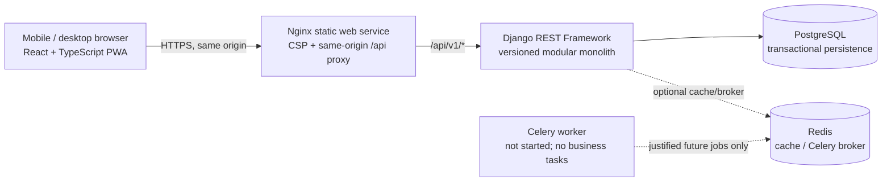
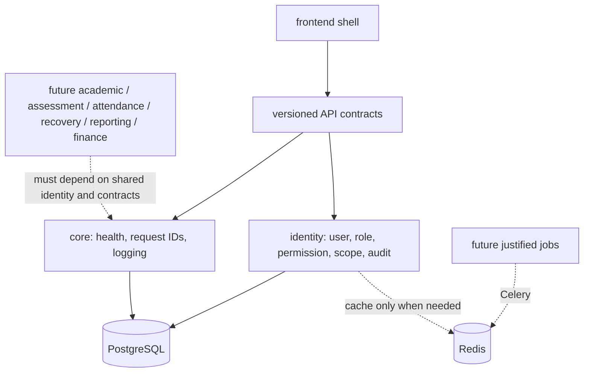

# Architecture overview — Prompt 01 foundation

## Status and scope

This is a modular-monolith foundation, not a deployed or school-approved production system. The Owner explicitly reopened Prompt 01 for engineering-foundation work only; all business-module, policy, integration, pilot, and release gates remain closed. The stack below follows the Prompt 01 recommendation. No architecture deviation is proposed.

## System context

Local development uses Vite on `:5173`, Django on `:8000`, PostgreSQL and Redis on loopback-bound development ports. Vite proxies relative `/api/*` requests to Django; browser code has no localhost URL or CORS bypass. The future web service uses Nginx to proxy `/api/*` to a separately configured API service, preserving same-origin session cookies and CSRF checks.

## Dependency direction

The future business domains must remain separate packages with explicit service/API boundaries. They must not import one another's private models. Shared invariants (authorization, audit, configuration versioning, transaction ownership) belong in the platform layer or in narrowly defined domain services.

## Runtime contracts

- API prefix: `/api/v1/`, using DRF namespace versioning. `v1` is the only accepted version in this foundation.
- Health: `/api/v1/health/live/` reports process liveness only; `/api/v1/health/ready/` checks one constant PostgreSQL query. Neither checks Redis, Celery, or future business functionality.
- Authentication: Django session cookies, JSON CSRF-token endpoint, same-origin requests. No JWT, local-storage token, public sign-up, default account, or API key is created.
- Authorization: API defaults to authenticated access. Future private views must use a server-side permission contract and resolve record scope from trusted server-side state. A client-side navigation item is not an authorization check.
- Jobs: Celery app and Redis settings are present; no task is registered or dispatched. Add a job only after the process, retry, idempotency, visibility, privacy and failure-handling need is reviewed.
- Offline: the service worker may precache static shell assets only. It does not cache or queue authenticated API responses, marks, learner records, payments, or financial actions.

## Data and environment

PostgreSQL is the target persistence engine. Local `config.settings.test` uses an isolated in-memory SQLite database. GitHub Actions runs the backend suite against a disposable PostgreSQL 16 service using the explicit `config.settings.ci_postgres` module; it does not use production infrastructure or records. The first domain schema is a conceptual design in [data architecture](data-architecture.md); there are no committed migrations, seed records, or production database actions in this milestone.

All runtime secrets are supplied via environment variables. The tracked `.env.example` contains blank secret fields and local-only variable names, never credentials. Railway files are templates; they do not create a project or resources.

## Quality and operational posture

GitHub Actions validates frontend build/type/lint/tests, backend checks/tests/types/lint, dependency advisories and repository configuration. Merge/deploy approval, backup/restore evidence, Postgres production tuning, observability, incident response and security review remain separate Owner gates.
