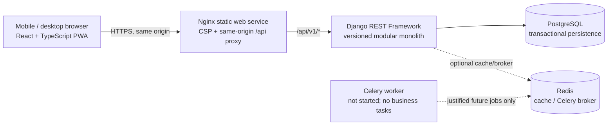
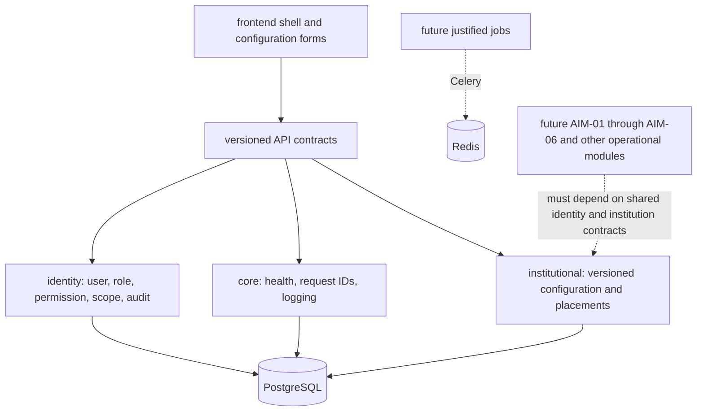

# Architecture overview — Prompt 01/02 foundation and Prompt 03 configuration

## Status and scope

This is an owner-controlled modular-monolith engineering foundation, not a deployed or school-approved production system. Prompt 01/02 authentication, identity, PWA and CI foundations are preserved. Prompt 03 adds an institution-aware versioned configuration foundation; implementation acceptance remains with the Owner. AIM-01 through AIM-06 and later operational modules, policy activation, live data, shared/production migration execution, pilot and release gates remain closed.

## System context

Local development uses Vite on `:5173`, Django on `:8000`, PostgreSQL and Redis on loopback-bound development ports. Vite proxies relative `/api/*` requests to Django; browser code has no localhost URL or CORS bypass. The future web service uses Nginx to proxy `/api/*` to a separately configured API service, preserving same-origin session cookies and CSRF checks.

## Dependency direction

Future operational domains must remain separate packages with explicit service/API boundaries. They must not import one another's private models. Shared invariants (authorization, audit, configuration versioning and transaction ownership) belong in the platform layer or narrowly defined domain services.

## Runtime contracts

- API prefix: `/api/v1/`, using DRF namespace versioning. `v1` is the only accepted version.
- Health: `/api/v1/health/live/` reports process liveness only; `/api/v1/health/ready/` checks one constant PostgreSQL query. Neither checks Redis, Celery, or future business functionality.
- Authentication: Django session cookies, JSON CSRF-token endpoint, same-origin no-store requests, generic credential errors, server-reported expiry and client expiry handling. Django `is_staff`/`is_superuser` accounts must complete RFC 6238 TOTP; seeds are AES-GCM encrypted using a separate environment key. Recovery tokens are hashed, single-use and deliverable only through an explicitly configured adapter; no adapter is included or active.
- Authorization: API defaults to authenticated access. Role and permission identifiers are derived from effective server-side grants; `HasRBACPermission` and scoped-query helpers fail closed for missing contracts and exact scope grants. Institution creation requires a distinct global permission; institutional reads and writes require the route institution's exact scope. No grants are seeded, and UI visibility is not authority.
- Institutional configuration: `/api/v1/institutions/` lists only already granted institution scopes; a new institution registration does not grant access. Release, schema, academic-resource, staff-affiliation and opaque-enrolment endpoints are versioned under `/api/v1/`. Release resources can be edited only while draft; submission and independent approval are separate; approved snapshots are immutable. Staff membership is not an RBAC grant.
- Effective dates: approved configuration is resolved with an explicit institution-local date. The application does not infer a local calendar, timezone, locale, or effective policy. School-specific date rules require Owner review.
- Jobs: Celery app and Redis settings are present; no task is registered or dispatched. Add a job only after process, retry, idempotency, visibility, privacy and failure handling are reviewed.
- Offline: the service worker precaches public static shell assets only, prompts before activating updates, excludes `/api/` navigations, and has no runtime cache rules. API fetches and responses carry no-store directives; no credentials, learner records, financial data or writes are cached or queued.

## Data and environment

PostgreSQL is the target persistence engine. Local `config.settings.test` uses an isolated in-memory SQLite database. GitHub Actions is configured to run the backend suite against a disposable PostgreSQL 16 service using `config.settings.ci_postgres`; this does not use production infrastructure or records. Prompt 03 adds an initial migration for the `institutional` app. Identity MFA/recovery test tables retain the CI-only creation arrangement. The migration has not been executed against any shared or production database.

No school values, calendars, classes, subject choices, financial rates or role grants are seeded. The schema, tenant boundary and future module interfaces are described in [data architecture](data-architecture.md). Railway files remain templates and no production environment has been populated.

## Quality and operational posture

GitHub Actions validates frontend build/type/lint/tests, backend system checks/tests/types/lint, dependency advisories and repository configuration. A passing CI run is engineering evidence only. Owner acceptance, schema/security review, access-policy approval, backup/restore evidence, observability, incident response, UAT and any deployment decision remain separate gates.
